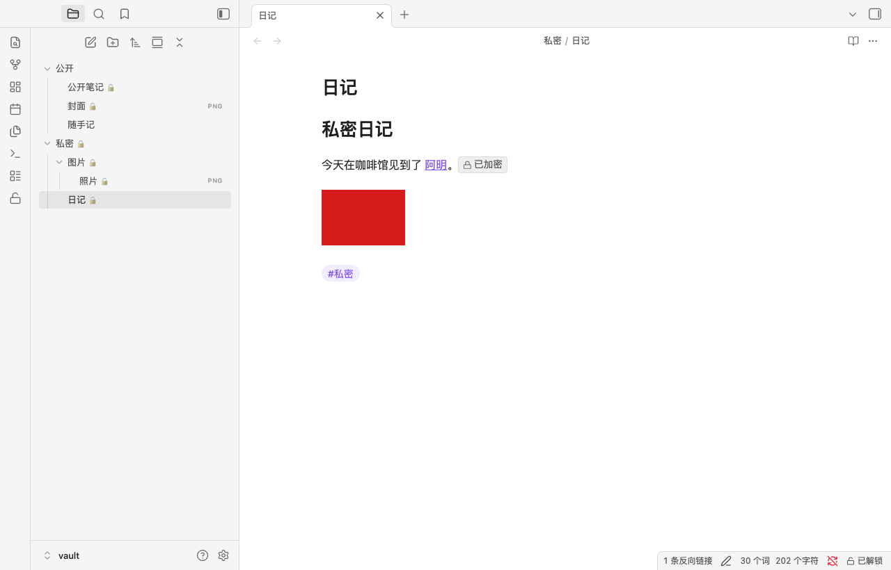
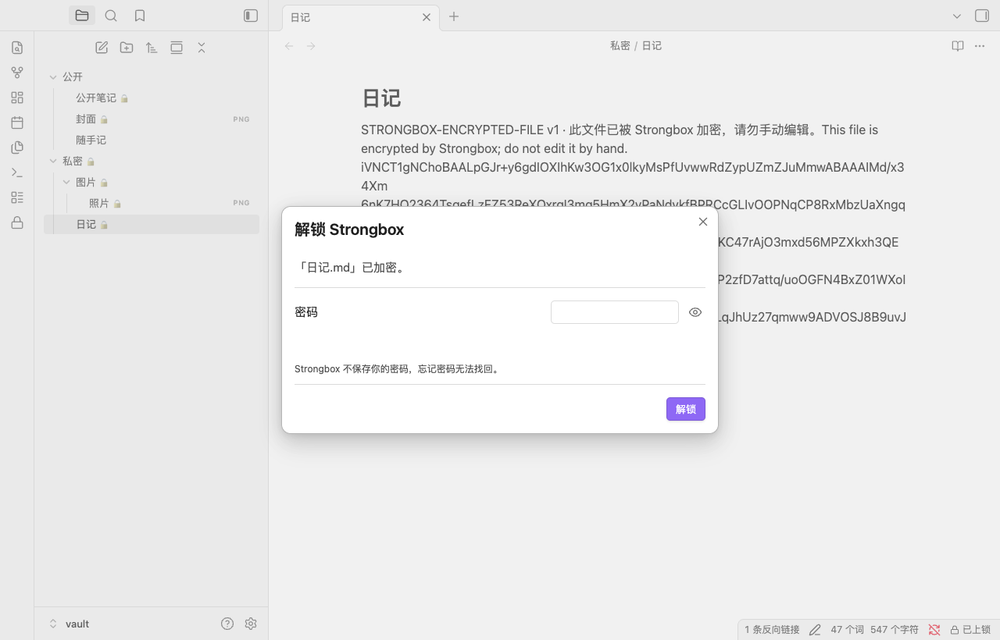
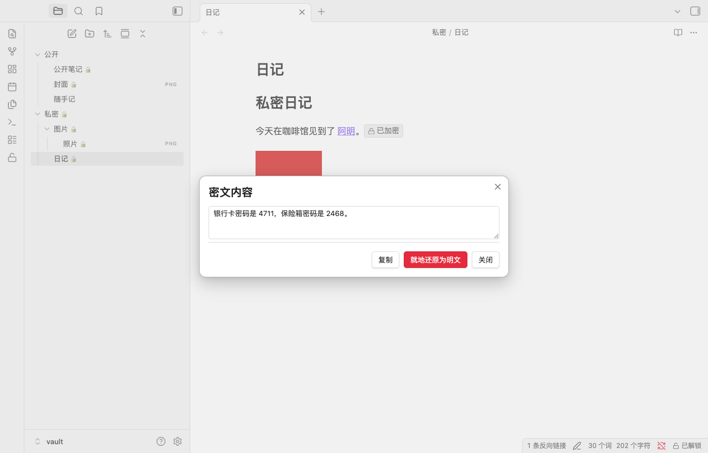
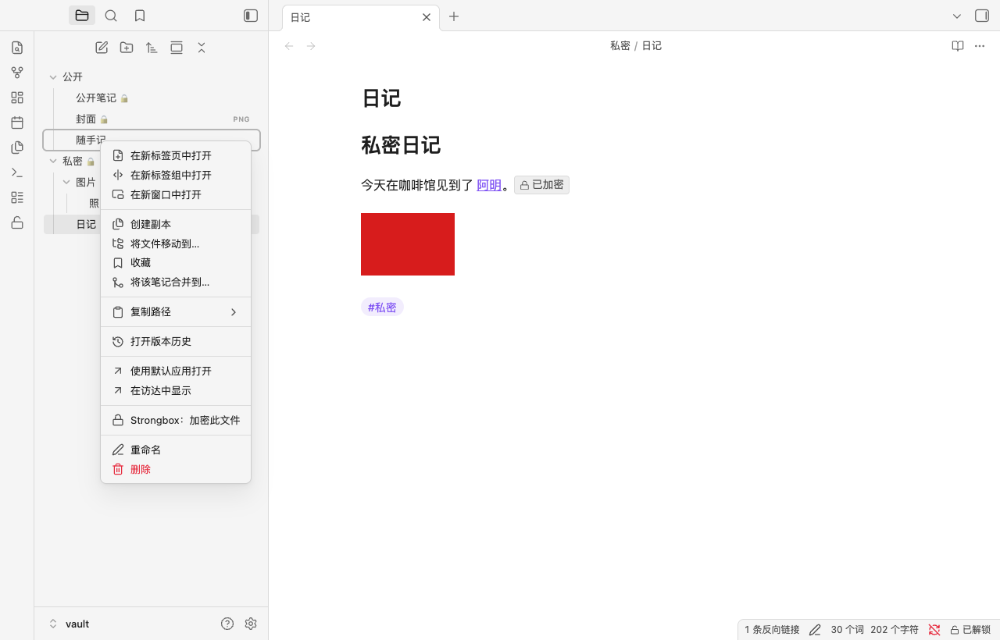
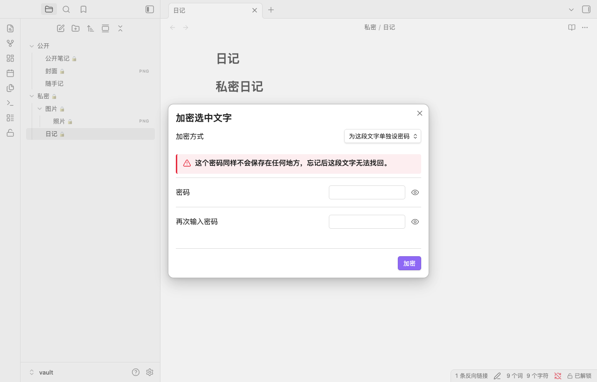
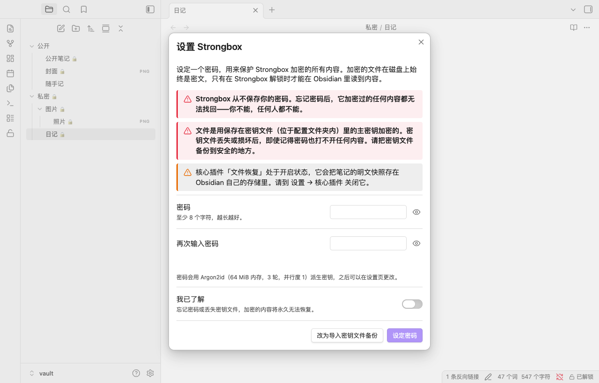
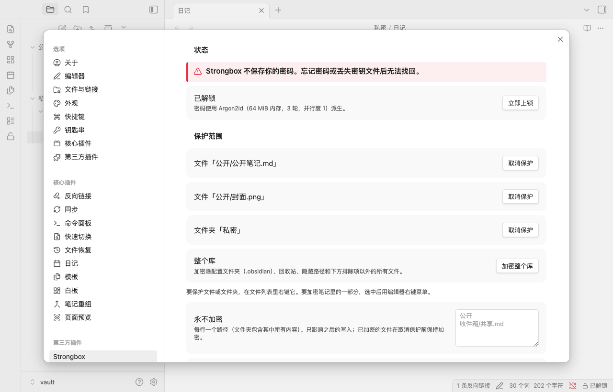

# Strongbox

> Obsidian 加密插件：选中的文字、单个文件（连同附件）、整个文件夹或整个库，在磁盘上始终是密文。明文只在解锁后的内存里存在。

[English](README.md) | 中文


解锁后，受保护的笔记和平常一样阅读、编辑、搜索、双链；上锁后，别人直接打开库目录、备份或同步盘，只能看到密文。



> [!WARNING]
> **Strongbox 不保存你的密码。忘记密码，或丢失密钥文件，加密的内容任何人都无法找回。** 设置完成后请立即备份密钥文件。

---

## 亮点

- **磁盘上始终是密文。** 插件在 Obsidian 读写文件的那一层加解密：解锁时读到的是明文，写到磁盘的是密文；上锁时任何会让明文落盘的写入都会被拒绝。
- **想加密多少就加密多少。** 一段文字、一个文件（可连同它引用的图片和附件）、一个文件夹，或者整个库。
- **加密后照常使用。** 文件名和路径不变，解锁后搜索、双链、标签、关系图、反向链接照常工作；图片在实时预览和阅读模式下正常显示。
- **可靠的批量加密。** 每个文件先写临时副本、读回校验能解开，才替换原文件；有日志，崩溃或取消后可以续跑。
- **自动上锁。** 空闲超时、手机切到后台、手动上锁；上锁时丢弃内存里的密钥，关闭受保护文件的标签页。
- **成熟的加密算法。** 密码经 Argon2id（或 PBKDF2）派生密钥，内容用 AES-256-GCM 加密；篡改、截断、调换都能被发现。
- **不联网，无外部依赖。** 运行时不发任何网络请求，不使用 Node 模块，桌面和手机用同一份代码。
- **中英双语界面。** Obsidian 的语言是中文时显示中文，其他任何语言都显示英文。

## 截图

<table>
  <tr>
    <td align="center"></td>
    <td align="center"></td>
  </tr>
  <tr>
    <td align="center">上锁后，磁盘上的笔记只是密文，打开时弹出解锁窗口</td>
    <td align="center">点开行内密文标记，查看、复制或还原原文</td>
  </tr>
  <tr>
    <td align="center"></td>
    <td align="center"></td>
  </tr>
  <tr>
    <td align="center">在文件列表里右键加密文件或文件夹</td>
    <td align="center">选中文字后加密，可以为它单独设密码</td>
  </tr>
  <tr>
    <td align="center"></td>
    <td align="center"></td>
  </tr>
  <tr>
    <td align="center">初始化向导：设定密码前先讲清楚风险</td>
    <td align="center">设置页：状态、保护范围、排除项</td>
  </tr>
</table>

---

## 安装

### 从社区插件市场安装

Strongbox 已提交到社区插件市场，上架后：

1. 打开 **设置 → 第三方插件 → 浏览**。
2. 搜索 **Strongbox**，点 **安装**，再点 **启用**。

### 手动安装

1. 从 [Releases 页面](https://github.com/senjanson/obsidian-strongbox/releases) 下载最新版本的 `main.js`、`manifest.json`、`styles.css`。
2. 在库里新建文件夹 `.obsidian/plugins/strongbox/`（如果你改过配置文件夹名，用你的名字），把这三个文件放进去。
3. 在 Obsidian 里打开 **设置 → 第三方插件**，关闭安全模式，启用 **Strongbox**。

**先在测试库里试用**，或者确保你的库有完整备份。

## 开始使用

1. 启用插件后，打开 **设置 → Strongbox → 开始设置**。第一次执行任何加密操作时也会自动弹出向导。
2. 阅读警告，设定密码（至少 8 个字符，越长越好）并再次输入，打开「我已了解」后点「设定密码」。
3. **立即备份密钥文件**（向导第二步）：下载（仅桌面端）、复制为文本，或在库中保存一份副本。把备份放在这个库之外，比如密码管理器里。保留默认文件名的备份永远不会被加密，即使整库加密也一样。
4. 建议关闭核心插件「文件恢复」（设置 → 核心插件），否则它会把笔记的明文快照存在 Obsidian 自己的存储里。向导和设置页都会提示它的状态。

之后：

- **加密文件或文件夹**：在文件列表里右键 →「Strongbox：加密此文件」/「Strongbox：加密此文件夹」。加密笔记时可以勾选同时加密它引用的附件。
- **加密一段文字**：选中后右键「加密选中文字」，选择用库密码（主密钥），或为这段文字单独设密码。独立密码同样不保存，忘记后这段文字无法恢复。
- **加密整个库**：命令「加密整个库」或设置页的「加密整个库」按钮。配置文件夹、回收站 `.trash`、以点开头的路径和排除列表里的路径不加密。
- **上锁 / 解锁**：左侧栏的锁形图标、桌面状态栏，或命令「立即上锁」「解锁」。

### 命令

| 命令 | 作用 |
| --- | --- |
| 立即上锁 / 解锁 | 手动上锁或解锁 |
| 加密选中文字 | 把选中文字换成行内密文块 |
| 解密光标处的密文 | 把光标所在的密文块还原为原文 |
| 加密当前文件 | 加密当前打开的文件（可连同附件） |
| 取消保护并解密当前文件 | 取消当前文件的保护，写回明文 |
| 加密整个库 / 取消整库保护并解密 | 整库加密或解密（批量任务） |
| 修改密码 | 快速改密：只重新包裹主密钥，文件不动 |
| 彻底换钥：生成新主密钥并重新加密全部内容 | 换一把新主密钥，重新加密所有文件和用库密码加密的行内密文块 |
| 继续未完成的加密任务 | 续跑被取消或中断的批量任务 |

### 上锁和解锁

- 上锁的方式：手动（命令、侧栏图标、状态栏）、空闲超时（默认 10 分钟）、手机切到后台超过设定时间（默认 60 秒，设为 0 表示一切到后台就上锁）。
- 上锁时：丢弃内存中的密钥；保存并关闭受保护文件的标签页；撤销附件的 Blob URL；清掉 Obsidian 对受保护文件的内容缓存，并重新执行打开着的搜索。
- 上锁期间：读取受保护文件得到的是密文外壳；所有会让明文落盘的写入（保存、新建、追加）都会被拒绝，并提示先解锁；未受保护的文件照常读写。打开受保护文件会弹出解锁窗口。
- 只有一个解锁窗口：密码错误会直接提示，解锁后已打开的视图自动刷新为明文。

### 改密码

- **快速改密**：用新密码重新包裹主密钥，只改密钥文件，几乎瞬间完成。改完要重新导出备份：旧备份仍然可以用旧密码打开。
- **彻底换钥**：生成新主密钥，批量重新加密所有加密文件（包括回收站里的）和用库密码加密的行内密文块；可以中断续跑；全部完成并确认旧密钥不再被使用后，才把它从密钥文件里删掉。

### 换设备

密钥文件在 `<配置文件夹>/plugins/strongbox/keyring.json`。把插件和配置一起同步到新设备，或者在新设备的设置页「导入密钥文件备份」，然后用原来的密码解锁。

### 隐藏文件名（实验性，默认关闭）

开启后，上锁时把受保护的文件和文件夹改名为随机占位名（`sbx-` 加 16 位十六进制），真实目录结构加密保存为清单；解锁时改回原名。只改名，不重写内容；每一步都有日志，中断后可以恢复。上锁期间，在占位名的文件夹里新建或写入文件会被拒绝。

## 设置

| 设置 | 默认 | 说明 |
| --- | --- | --- |
| 保护范围 | 无 | 列出所有受保护的文件、文件夹和整库规则，每条都能取消保护 |
| 永不加密 | 空 | 每行一个路径（文件夹包含其中所有内容）。只影响之后的写入：已加密的文件在取消保护前保持加密 |
| 文本类文件类型 | `md`、`canvas`、`base` | 这些类型落盘时是一行提示加 base64，其他工具看起来仍是文本；其他文件用紧凑的二进制容器 |
| 空闲多久后上锁（分钟） | 10 | 0 表示关闭 |
| 手机：切到后台多久后上锁（秒） | 60 | 0 表示立即，-1 表示从不 |
| 在状态栏显示锁定状态 | 开 | 桌面端 |
| 加密文件时默认连同附件一起加密 | 开 | 加密笔记时「同时加密它的 N 个附件」默认勾选 |
| 密码派生算法 | Argon2id，64 MiB，3 轮，并行度 1 | 也可以选 PBKDF2-SHA-256（默认 60 万次迭代）；下次设定密码时生效 |
| 密钥文件 | | 导出备份（桌面端下载 / 复制为文本 / 在库中保存副本）、导入备份 |
| 上锁时隐藏文件名和目录结构 | 关 | 实验性，见上文 |

## 工作原理

### 两层密钥

- 你的密码经 Argon2id（或 PBKDF2-SHA-256）派生出**包裹密钥**。
- 真正加密内容的是随机生成的 256 位**主密钥**，它被包裹密钥用 AES-256-GCM 加密后存在密钥文件里。能否解开就是验证密码的方式，插件不存任何密码哈希。
- 每个文件的密钥 = HKDF-SHA-256(主密钥, 文件盐)。文件每次写入都会换一个新的随机盐，所以每次保存的密文都不同。
- 主密钥在内存中是不可导出的 `CryptoKey`，原始字节解包后立即清零；上锁时丢弃。

### 读写挂接

插件挂接 `app.vault.adapter` 的 `read`、`readBinary`、`write`、`writeBinary`、`append`、`process`：

- 解锁时：读到带 Strongbox 文件头的内容自动解密；写入受保护路径，或者覆盖一个已经加密的文件，自动加密。
- 上锁时：读取原样返回密文；需要加密的写入一律拒绝，所以明文永远不会落盘。
- 已经是密文的内容（比如同步工具原样复制的文件）直接写入；但如果新密文和磁盘上的密文文件盐相同、字节不同，只可能是有人手改了密文，这种写入会被拒绝，避免文件损坏。
- 停用插件时会恢复 adapter 原来的方法。

图片、音视频、PDF 由 Obsidian 按资源 URL 直接从磁盘加载，不经过上面的读写方法。插件用 MutationObserver 把指向已加密附件的元素换成解密后的 Blob URL，上锁时全部撤销。

### 批量引擎

首次加密、取消保护、彻底换钥共用一个批量引擎：桌面端 4 路并发，手机端 2 路。每个文件先写入临时副本、读回校验能解开，再替换原文件；替换前如果发现原文件在任务期间被改过，就跳过这个文件，留待续跑，不会用旧内容覆盖新改动。所有进度写入日志，崩溃、强制退出或取消后都可以续跑；已处理的文件自动跳过。

## 文件格式

### 密钥文件 `keyring.json`

位置：`<配置文件夹>/plugins/strongbox/keyring.json`（配置文件夹取自 `app.vault.configDir`，不写死 `.obsidian`）。

```json
{
  "format": "strongbox-keyring",
  "version": 1,
  "kdf": { "alg": "argon2id", "memKiB": 65536, "iterations": 3, "parallelism": 1, "salt": "<base64>" },
  "activeKeyId": 2864430421,
  "keys": [ { "id": 2864430421, "created": 1763600000000, "wrapped": "<base64(iv‖AES-GCM(主密钥))>" } ]
}
```

- 每把主密钥用 AES-256-GCM 包裹，附加认证数据是 `strongbox-keyring/v1/key/<id>`，编号和密钥绑定，不能挪用。
- 换钥期间 `keys` 里同时有新旧两把主密钥，`activeKeyId` 指向写入时用的那把。

### 文件容器

```
偏移  长度  字段
0     8     魔数 89 53 42 4F 58 0D 0A 1A（"\x89SBOX\r\n\x1a"）
8     1     版本（1）
9     1     标志（保留，0）
10    4     主密钥编号（uint32 大端）
14    32    文件盐（每次写入重新随机生成）
46    4     明文分块大小（uint32 大端，默认 64 KiB）
50    ...   分块密文
```

- 文件密钥 = HKDF-SHA-256(主密钥, salt = 文件盐, info = `strongbox/file/v1`)。
- 每块 AES-256-GCM，16 字节认证标签。随机数 = 4 个零字节 + 8 字节块序号（每次写入换盐即换密钥，所以确定性随机数是安全的）。
- 附加认证数据 = 文件头 ‖ 块序号 ‖ 「是否最后一块」标志：改文件头、截掉末尾、调换块顺序都会认证失败。
- 路径不参与认证：改名、移动文件不需要重写内容。

### 文本外壳

「文本类文件类型」落盘时用文本外壳，内层是同一种容器：

```
STRONGBOX-ENCRYPTED-FILE v1 · 此文件已被 Strongbox 加密，请勿手动编辑。This file is encrypted by Strongbox; do not edit it by hand.
iVNCT1gNChoBAAAAAAEj...（base64，每行 76 个字符）
```

读取时两种形式都认，与扩展名无关。只有「首行前缀 + 能解出合法容器的 base64」才算密文，所以一篇恰好引用了这行文字的普通笔记不会被误判。

### 行内密文块（选中文字）

写成一个行内代码，Markdown 不会改动其中内容，也不会跨行：

```
`strongbox:v1:k<密钥编号>:<数据>`                ← 用主密钥
`strongbox:v1:p:<派生参数>:<盐>:<数据>`          ← 用独立密码
```

- 派生参数：`a<内存KiB>.<轮数>.<并行度>`（Argon2id）或 `p<迭代次数>`（PBKDF2）；盐和数据都是 base64url。
- 主密钥模式：数据 = 盐(16) ‖ IV(12) ‖ 密文，密钥 = HKDF(主密钥, 盐, `strongbox/inline/v1`)。
- 独立密码模式：数据 = IV(12) ‖ 密文，密钥直接由密码派生。
- 附加认证数据是数据前面的整段前缀，参数被篡改即解密失败。

### 插件自己的文件

都在 `<配置文件夹>/plugins/strongbox/` 下：

| 文件 | 作用 |
| --- | --- |
| `data.json` | 设置和保护规则（**明文**） |
| `keyring.json`（及写入中的 `keyring.json.new`） | 密钥文件 |
| `batch-journal.log` | 批量任务日志（每行一个 JSON），任务完成后删除 |
| `tmp/` | 批量任务的临时副本 |
| `names.sbx`、`names.sbx.bak` | 隐藏文件名的对照表（用主密钥加密） |
| `names-journal.log` | 隐藏 / 恢复文件名的进度日志（只记序号，不含名字） |

## 安全模型

**能防住的**：别人拿到你的磁盘、备份或同步盘里的文件（包括拿到一台已上锁的设备，或在上锁后查看库目录），看不到受保护文件和行内密文块的内容。篡改、截断、调换分块都会被发现，不会被当成正常内容读出。

**防不住的**：

- 解锁期间能操作你电脑或 Obsidian 的人，以及你装的其他插件，能看到明文。
- 弱密码。Argon2id / PBKDF2 只是让暴力破解变慢。
- 磁盘上残留的旧明文：首次加密是覆盖写入，文件系统、SSD、快照、版本历史、云盘回收站里可能还有旧版本。
- 文件名、大致的文件大小、修改时间默认可见。

**插件从不保存密码**：忘记密码无法找回；密钥文件丢失后，即使记得密码也解不开。

## 已知局限

- **元数据缓存会保留明文痕迹。** 解锁时 Obsidian 读到的是明文，标题、标签、链接等元数据会进入它自己的元数据缓存（内存和 IndexedDB）。上锁时插件会清掉 Obsidian 对受保护文件的**内容**缓存，并重新执行搜索，所以上锁后搜索不到受保护内容；但反向链接数量、标题大纲、标签列表这类**元数据**仍然可见。
- **核心插件「文件恢复」会保存明文快照**，请关闭（设置页有状态提示）。
- **Obsidian 内的同步插件读到的是明文。** 在 Obsidian 内部运行的同步插件（Obsidian Sync、Remotely Save、LAN Vault Sync 等）走同一个 adapter，解锁时拿到并发送的是明文。在 Obsidian 外部运行的同步工具（iCloud、Syncthing、命令行 Git 等）看到的是磁盘上的密文。
- **文件名默认可见。** 隐藏文件名是实验性功能：开启后保护规则的路径仍以明文保存在 `data.json` 里；只在上锁时隐藏（直接关闭 Obsidian 不会隐藏）；改名对同步工具来说就是移动文件。
- **上锁时读取返回密文。** Obsidian 可能为上锁期间变化的文件建立「密文」索引，要等文件下次变化才会重新索引。
- **PDF、音视频附件的显示未验证。** 图片已在真实 Obsidian 里验证；PDF 查看器可能走别的加载路径，可能显示不出来。
- **文件列表的锁形标记**依赖 Obsidian 的非公开接口（文件浏览器的 `fileItems`）。接口变化时只是不显示，不影响加密。
- **多任务界面的缩略图可能露出明文。** 手机端一切到后台，Strongbox 就隐藏界面；但 Android 在插件收到通知之前就截好了多任务缩略图，所以即使设成「切到后台 0 秒就上锁」，缩略图里仍可能看到当前笔记。介意的话，离开 App 前先手动上锁。
- **手机端只在一台 Android 和一台 iPhone 上实测过**（见下文），其他机型、旧系统版本和平板没测。
- **停用插件时**：Obsidian 不等待插件卸载，所以插件会先保存并关闭受保护文件的标签页，并让读写挂接和密钥再保留约 3 秒，确保这些保存仍是加密的，之后才丢弃密钥、恢复 adapter。
- **排除列表只影响之后的写入。** 已经加密的文件即使后来被加入排除列表，写入时仍保持加密，直到对它「取消保护」。
- **大文件整块读入内存**再加解密（没有流式处理）。
- `.git`、`.github` 等以点开头的路径一律不加密。

## 测试情况

- **自动化测试**：93 个单元测试和集成测试（Node 环境，用假 adapter / 假 App），覆盖加密核心、读写挂接、批量引擎的崩溃续跑、隐藏文件名的中断恢复等。
- **真实 Obsidian（macOS 桌面端，Obsidian 1.12.4，独立的测试库）**，已验证：
  - 插件加载、挂接 adapter；停用后恢复原状，再次启用正常。
  - 初始化向导：密码不一致报错，「我已了解」未打开时不能创建；Argon2id 64 MiB 派生约 0.2 秒。
  - 加密文件夹后磁盘上全是文本外壳或二进制容器，没有明文；在 Obsidian 里正常阅读、编辑，保存后仍是密文。
  - 实时预览和阅读模式下图片正常显示；文件列表锁形标记、双链、标签、反向链接、搜索正常。
  - 上锁：受保护标签页关闭；修改、新建、追加、`process`、新建二进制文件都被拒绝；未受保护的文件照常可写；打开受保护文件弹出解锁窗口；内容缓存被清除，搜索不到受保护内容。
  - 解锁：错误密码提示，正确密码后自动刷新为明文。
  - 行内密文（库密码和独立密码两种模式）在实时预览和阅读模式下显示为标记，点开能看原文。
  - 单个文件连同附件加密；隐藏文件名后真实改名再恢复，保护规则保持正确；彻底换钥后旧密钥被删除，行内密文块也换成新密钥；空闲自动上锁；取消文件夹保护后还原为明文；改名文件和文件夹时规则同步更新。
  - 界面语言：中文显示中文；英文、日文等显示英文。
  - 加密约 400 个文件的整个库：`.obsidian` 和 `.trash` 不受影响；进度 35% 时取消，再从设置页续跑完成。
  - 彻底换钥过程中强制退出 Obsidian（kill -9）：重启并解锁后续跑完成，所有文件都用新密钥打开，旧密钥被删除。
  - 快速改密（文件修改时间不变）；删除密钥文件后导入备份恢复。
  - 受保护标签页有未保存修改时停用插件：修改被加密保存，磁盘上始终没有明文，宽限期后 adapter 恢复。
  - 弹出窗口：加密图片能显示，也能在里面加密选中文字。
- **手机真机**（独立的测试库，通过 USB 远程调试操作），已验证：
  - **Android**：Pixel 9a，Android 17，Obsidian 1.12.7。
  - **iOS**：iPhone 15，iOS 18.4.1，Obsidian 1.15.1。
  - 插件加载正常，不依赖 Node 模块；批量任务同时处理 2 个文件。Argon2id 64 MiB：Pixel 约 0.47 秒，iPhone 约 0.24 秒。
  - 磁盘上是密文（通过 USB 读回确认）；编辑、保存、新建、追加后仍是密文；中文路径的图片通过 Blob URL 正常显示。
  - 上锁和解锁、密码错误、上锁后写入被拒绝、空闲上锁、切后台上锁（0 秒、短时间离开、长时间离开）。
  - 批量任务：Pixel 上 200 个文件加密 16.7 秒；切到后台后任务继续跑；iPhone 上在 312 个文件的第 124 个取消，续跑后正常完成。
  - 大文件：Pixel 上 5 MB 笔记解密约 0.45 秒；iPhone 上 3 个文件共约 9.7 MB 加密 1.4 秒。
  - 行内密文两种模式（独立密码在上锁时也能查看）；复制密钥文件、在库中保存副本；通过系统文件选择器导入密钥文件（Android）。
  - Mac 加密的文件两台手机都能打开，反过来也一样（同一密码和密钥文件）。
  - 解锁状态下停用插件，宽限期后 adapter 恢复原状（iPhone）。
  - 真机测试发现并已修复：iOS 上 `.txt`、`.json` 这类二进制容器文件读不出来；保存在库里的密钥备份会被「加密整个库」加密；iPhone 的 Obsidian 跟随系统显示中文时，Strongbox 却显示英文；手机上「下载」按钮没反应（现在只在桌面端显示）；手机上的「右键」提示（现在改为「长按」）；解锁后，已打开的搜索面板不会重新搜出受保护笔记。
- **未验证**：PDF 和音视频附件的显示；iOS 上隐藏界面能否挡住多任务缩略图；批量任务中途强制关闭手机 App（取消后续跑已验证）；Windows 和 Linux 桌面端。

## 手动测试清单

先用一个**测试库**，或完整备份过的库。

### 桌面端

- [ ] 启用插件后设置页显示「未设置」，提示忘记密码无法找回。
- [ ] 开始设置：两次密码不一致时报错；少于 8 个字符时报错；不打开「我已了解」时不能创建。
- [ ] 备份步骤：「下载」得到 `strongbox-keyring-日期.json`；「复制为文本」能粘贴出 JSON；「在库中保存副本」在库根目录生成 JSON。
- [ ] 右键一篇带图片的笔记 →「Strongbox：加密此文件」→ 勾选附件。用系统文本编辑器打开这个 `.md`：首行是提示，后面是 base64；图片用看图软件打不开。
- [ ] 在 Obsidian 里这篇笔记正常显示和编辑，图片正常显示，搜索能搜到正文，双链和关系图正常。
- [ ] 编辑后用外部编辑器再看：仍是密文，且每次保存内容都不同。
- [ ] 右键文件夹 →「Strongbox：加密此文件夹」：已有文件全部变成密文；在里面新建笔记，磁盘上直接是密文；把外面的明文笔记拖进来，几秒内变成密文。
- [ ] 命令「立即上锁」：受保护标签页关闭；状态栏和侧栏图标变成锁定；打开受保护笔记弹出解锁窗口；搜索搜不到受保护内容。
- [ ] 解锁：错误密码提示「密码错误」；正确密码后笔记恢复可读。
- [ ] 把「空闲多久后上锁」设为 1 分钟，不动鼠标键盘 1～2 分钟后自动上锁。
- [ ] 选中文字 →「加密选中文字」→ 库密码：变成 `` `strongbox:v1:k…` ``，两种视图都显示为标记；点开可查看、复制、就地还原。
- [ ] 独立密码模式：上锁状态下点开标记，输入独立密码也能看；错误密码提示无法解密。
- [ ] 命令「加密整个库」：`.obsidian`、`.trash` 下的文件保持原样。中途取消后设置页出现「未完成的任务」，点「继续」后完成。
- [ ] 加密过程中强制退出 Obsidian，重开后提示有未完成任务，解锁后继续，所有文件都能正常打开。
- [ ] 快速改密：旧密码不能再解锁，新密码可以；文件修改时间不变。
- [ ] 彻底换钥：完成后 `keyring.json` 里只剩一把密钥；所有文件和行内密文块仍能打开。
- [ ] 删除 `keyring.json` 后重启：无法解锁；导入备份后可以解锁。
- [ ] 开启「隐藏文件名」后上锁：受保护的文件和文件夹变成 `sbx-…`；解锁后名字全部恢复，内容不变。
- [ ] 取消文件、文件夹、整库的保护：对应文件变回明文。
- [ ] 解锁状态下停用插件：受保护标签页先保存再关闭；约 3 秒后再打开受保护文件只显示外壳文本；外部编辑器看磁盘始终是密文。

### 手机端（iOS / Android）

- [ ] 插件能加载；Argon2id 64 MiB 解锁在可接受的时间内完成。
- [ ] 解锁后受保护笔记可读可写，保存后从桌面端看仍是密文且能解开。
- [ ] 切到后台超过设定秒数再回来，已经上锁。
- [ ] 加密的图片能在笔记里显示。
- [ ] 批量加密能完成；中途切后台再回来能继续或续跑。
- [ ] 同一个库桌面端加密、手机端解锁（共用同步过去的 `keyring.json`）。

## 开发

```bash
npm install
npm run dev       # 监听构建
npm run build     # 生产构建，生成 main.js
npm test          # vitest
npx tsc --noEmit  # 类型检查
```

- 运行时唯一的依赖是 [`hash-wasm`](https://github.com/Daninet/hash-wasm)（Argon2id）。它的 WebAssembly 以 base64 内联在 JS 里，打包进 `main.js` 后从内存编译，不需要额外的 `.wasm` 文件，也不联网。
- AES-GCM、HKDF、PBKDF2 全部使用 Web Crypto（`crypto.subtle`）。
- 目录结构：
  - `src/crypto/`：加密核心，不依赖 `obsidian`。
  - `src/vault/`：读写挂接、保护规则、批量引擎、隐藏文件名。
  - `src/ui/`：弹窗、初始化向导、设置页、行内密文渲染、附件显示、文件列表标记。
  - `src/i18n.ts`：中英文界面文字。
  - `tests/`：单元测试，以及用假 adapter / 假 App 的集成测试。

## 许可证

MIT
