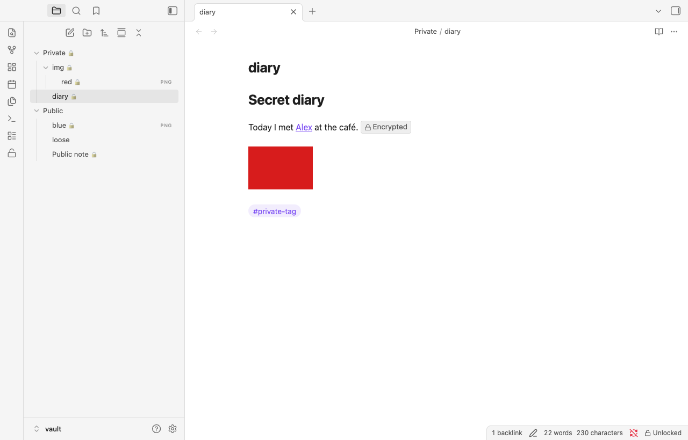
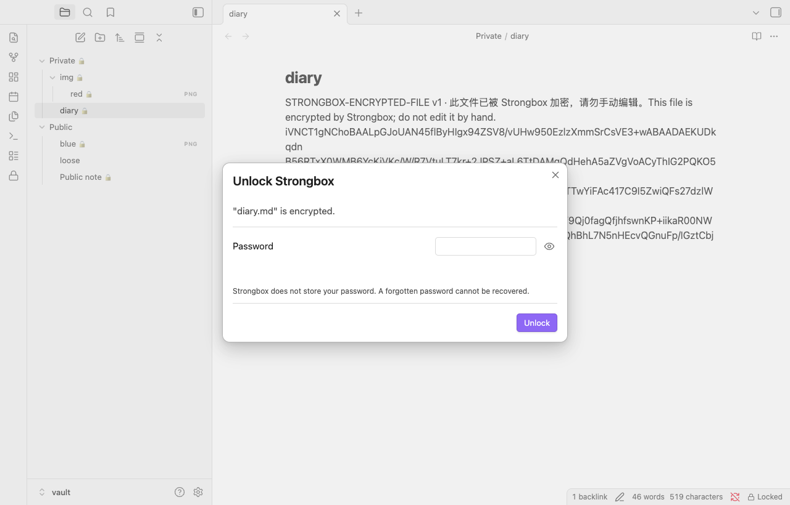
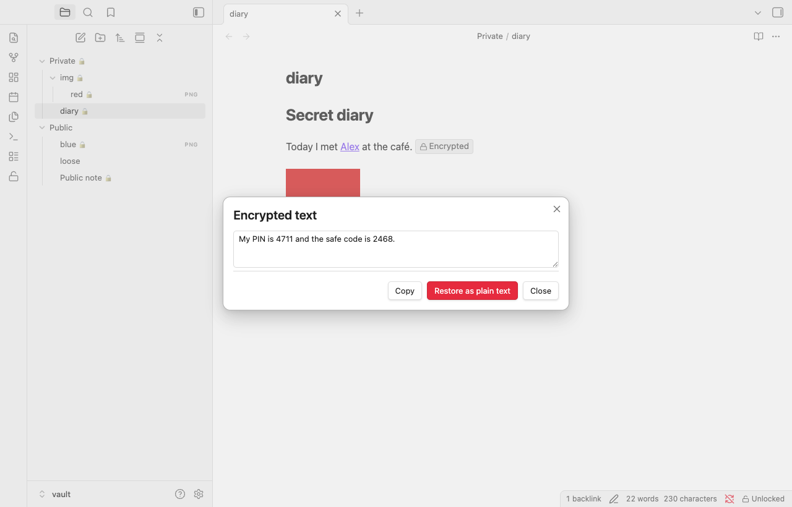
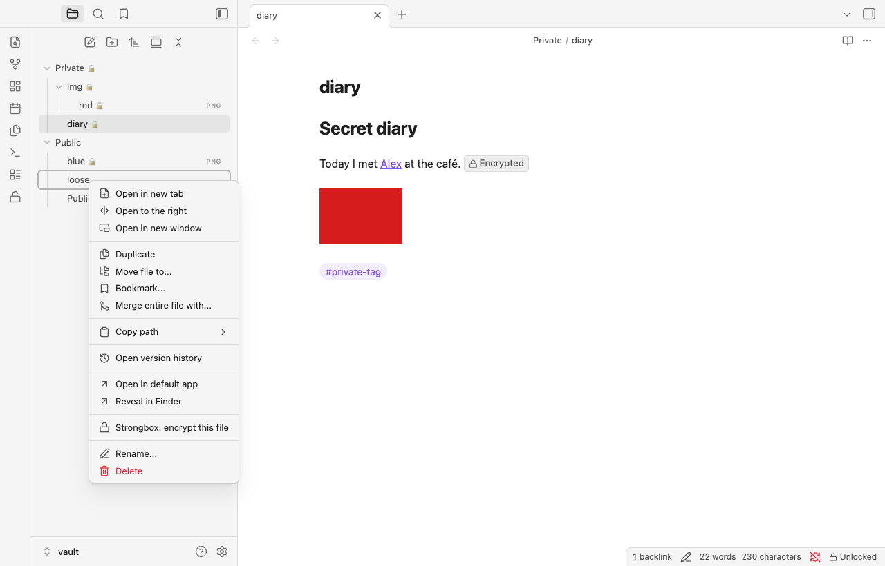
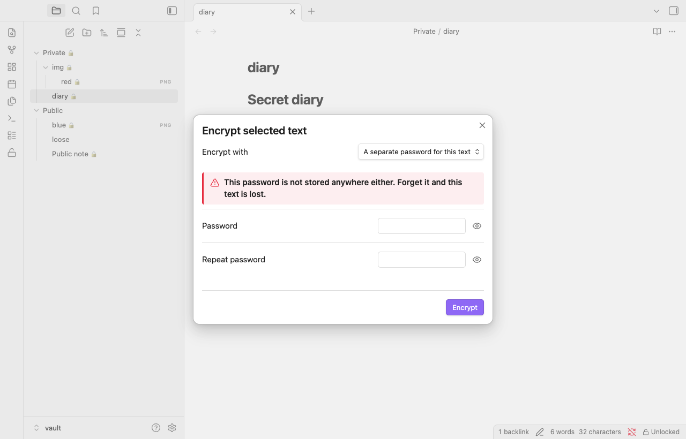
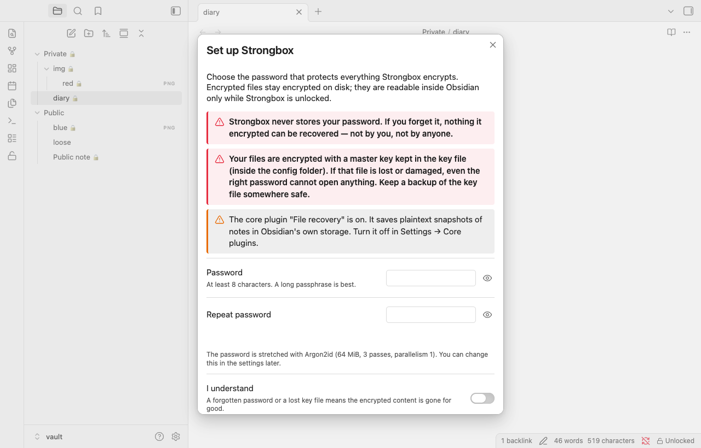
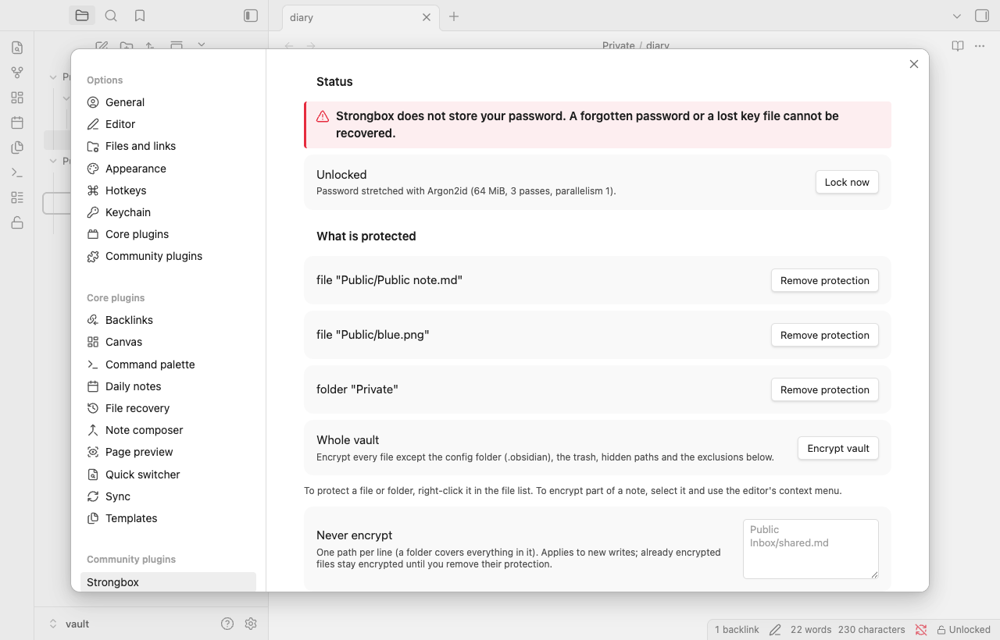

# Strongbox

> Encryption for Obsidian: selected text, single files (with their attachments), folders or the whole vault stay encrypted on disk. Plaintext exists only in memory while Strongbox is unlocked.

English | [中文](README-zh.md)


While unlocked, protected notes work like any other note: read, edit, search and link them as usual. Once locked, anyone who opens the vault folder, a backup or a synced copy sees only ciphertext.



> [!WARNING]
> **Strongbox never stores your password. If you forget it, or lose the key file, nobody can recover what it encrypted.** Back up the key file right after setup.

---

## Highlights

- **Ciphertext on disk, always.** Strongbox encrypts and decrypts at the layer where Obsidian reads and writes files: Obsidian sees plaintext while unlocked, the disk only ever receives ciphertext, and while locked every write that would put plaintext on disk is refused.
- **Encrypt as much or as little as you like.** A piece of text, one file (optionally with the images and attachments it uses), a folder, or the whole vault.
- **Everything keeps working.** File names and paths stay the same, so search, links, tags, the graph and backlinks work as usual once unlocked. Images show in Live Preview and Reading view.
- **Safe batch encryption.** Each file is written to a temporary copy and read back to check that it decrypts before it replaces the original. A journal lets an interrupted or cancelled job resume.
- **Locks itself.** After a period of inactivity, when the phone goes to the background, or by hand. Locking drops the keys from memory and closes protected tabs.
- **Well-known cryptography.** Your password is stretched with Argon2id (or PBKDF2); content is encrypted with AES-256-GCM. Tampering, truncation and reordering are detected.
- **No network, no extra dependencies.** No network requests and no Node modules at runtime: the same code runs on desktop and mobile.
- **English and Chinese.** The interface is in Chinese when Obsidian's language is Chinese, and in English for every other language.

## Screenshots

<table>
  <tr>
    <td align="center"></td>
    <td align="center"></td>
  </tr>
  <tr>
    <td align="center">Locked: the note on disk is only ciphertext, and opening it asks for the password</td>
    <td align="center">Click an encrypted text badge to view, copy or restore it</td>
  </tr>
  <tr>
    <td align="center"></td>
    <td align="center"></td>
  </tr>
  <tr>
    <td align="center">Right-click a file or folder to encrypt it</td>
    <td align="center">Encrypt selected text, optionally with its own password</td>
  </tr>
  <tr>
    <td align="center"></td>
    <td align="center"></td>
  </tr>
  <tr>
    <td align="center">Setup explains the risks before you choose a password</td>
    <td align="center">Settings: status, what is protected, exclusions</td>
  </tr>
</table>

---

## Installation

### From Community plugins

Strongbox has been submitted to the Community plugins directory. Once it is listed:

1. Open **Settings → Community plugins → Browse**.
2. Search for **Strongbox**, click **Install**, then **Enable**.

### Manual installation

1. Download `main.js`, `manifest.json` and `styles.css` of the latest release from the [Releases page](https://github.com/senjanson/obsidian-strongbox/releases).
2. Create the folder `.obsidian/plugins/strongbox/` in your vault (use your own name if you renamed the config folder) and put the three files in it.
3. In Obsidian, open **Settings → Community plugins**, turn off Restricted mode, and enable **Strongbox**.

**Try it on a test vault first**, or make sure you have a full backup of your vault.

## Getting started

1. After enabling the plugin, open **Settings → Strongbox → Set up**. The wizard also opens the first time you try to encrypt anything.
2. Read the warnings, enter a password (at least 8 characters; a long passphrase is best) twice, turn on **I understand** and click **Create password**.
3. **Back up the key file right away** (step two of the wizard): **Download** (desktop only), **Copy as text** or **Save copy in vault**. Keep the backup outside this vault, for example in your password manager. Backups that keep their default name are never encrypted, even inside an encrypted vault.
4. Turn off the core plugin **File recovery** (Settings → Core plugins). Otherwise it keeps plaintext snapshots of your notes in Obsidian's own storage. The wizard and the settings tab show whether it is on.

Then:

- **Encrypt a file or folder**: right-click it in the file list → **Strongbox: encrypt this file** / **Strongbox: encrypt this folder**. For a note you can also encrypt the attachments it uses.
- **Encrypt part of a note**: select the text, right-click → **Encrypt selected text**, and choose the vault password (master key) or a separate password for this text. A separate password is not stored either; forget it and that text is lost.
- **Encrypt the whole vault**: the command **Encrypt the whole vault**, or the **Encrypt vault** button in settings. The config folder, the trash `.trash`, paths starting with a dot and your exclusions are left alone.
- **Lock / unlock**: the lock icon in the left ribbon, the status bar on desktop, or the commands **Lock now** and **Unlock**.

### Commands

| Command | What it does |
| --- | --- |
| Lock now / Unlock | Lock or unlock by hand |
| Encrypt selected text | Replace the selection with an inline encrypted block |
| Decrypt the encrypted text at the cursor | Turn the block under the cursor back into plain text |
| Encrypt current file | Encrypt the open file (optionally with its attachments) |
| Remove protection from current file and decrypt it | Stop protecting the open file and write it back as plaintext |
| Encrypt the whole vault / Remove protection from the whole vault and decrypt it | Encrypt or decrypt the whole vault (a batch job) |
| Change password | Quick change: re-wraps the master key, files are not touched |
| Re-key: new master key, re-encrypt everything | Create a new master key and re-encrypt every file and every inline block that uses the vault password |
| Resume the unfinished encryption job | Continue a batch job that was cancelled or interrupted |

### Locking and unlocking

- Strongbox locks by hand (command, ribbon icon, status bar), after inactivity (10 minutes by default), and on phones after the app has been in the background for a while (60 seconds by default; 0 locks as soon as it goes to the background).
- Locking drops the keys from memory, saves and closes protected tabs, revokes attachment Blob URLs, clears Obsidian's cached content of protected files and re-runs open searches.
- While locked, reading a protected file returns the encrypted shell, and every write that would store plaintext (save, create, append) is refused with a request to unlock first. Unprotected files work as usual. Opening a protected file shows the unlock dialog.
- There is one unlock dialog. A wrong password is reported right away; after unlocking, open views refresh to plaintext.

### Changing the password

- **Change password** (quick): the master key is re-wrapped with the new password. Only the key file changes, so it takes a moment. Export a new key file backup afterwards: old backups still open with the old password.
- **Re-key** (thorough): a new master key is created, and every encrypted file (including those in the trash) and every inline block that uses the vault password is re-encrypted as a batch job that can be interrupted and resumed. The old key is removed from the key file only after Strongbox has checked that nothing uses it any more.

### Moving to another device

The key file lives at `<config folder>/plugins/strongbox/keyring.json`. Sync the plugin together with its settings to the new device, or use **Import a key file backup** in the settings there, then unlock with your password.

### Hiding file names (experimental, off by default)

When this is on, locking renames protected files and folders to random placeholders (`sbx-` plus 16 hex digits) and stores the real folder tree in an encrypted manifest; unlocking renames them back. Only names change, never content. Every step is journalled, so an interrupted rename can be recovered. While locked, creating or writing files inside a placeholder folder is refused.

## Settings

| Setting | Default | Notes |
| --- | --- | --- |
| What is protected | Nothing | Every protected file, folder and the whole-vault rule, each with **Remove protection** |
| Never encrypt | Empty | One path per line (a folder covers everything in it). Applies to new writes; already encrypted files stay encrypted until you remove their protection |
| Text-like file types | `md`, `canvas`, `base` | Stored as a warning line plus base64 so other tools still see text; other files use a compact binary container |
| Lock after inactivity (minutes) | 10 | 0 turns this off |
| Phone: lock after being in the background (seconds) | 60 | 0 locks at once, -1 never |
| Show lock state in the status bar | On | Desktop |
| Encrypt attachments with a file by default | On | Pre-ticks "Also encrypt its N attachment(s)" when you encrypt a note |
| Password stretching | Argon2id, 64 MiB, 3 passes, parallelism 1 | PBKDF2-SHA-256 (600,000 iterations) is also available; applies the next time a password is set |
| Key file | | Back up (download on desktop / copy as text / save copy in vault) and import |
| Hide file names and folder structure while locked | Off | Experimental, see above |

## How it works

### Two layers of keys

- Your password is stretched with Argon2id (or PBKDF2-SHA-256) into a **wrapping key**.
- Content is encrypted with a random 256-bit **master key**, stored in the key file encrypted with the wrapping key (AES-256-GCM). Whether it unwraps is how the password is checked; no password hash is stored.
- Each file's key is HKDF-SHA-256(master key, file salt). Every write uses a fresh random salt, so every save produces different ciphertext.
- In memory the master key is a non-extractable `CryptoKey`; its raw bytes are wiped right after unwrapping, and the key is dropped when Strongbox locks.

### The adapter hook

Strongbox hooks `read`, `readBinary`, `write`, `writeBinary`, `append` and `process` of `app.vault.adapter`:

- Unlocked: anything read that carries the Strongbox header is decrypted; anything written to a protected path, or over a file that is already encrypted, is encrypted first.
- Locked: reads return the ciphertext as it is; writes that would need encrypting are refused, so plaintext never reaches the disk.
- Data that is already ciphertext (for example a raw copy made by a sync tool) is stored as is. But ciphertext with the same file salt as the copy on disk and different bytes can only be hand-edited ciphertext, so that write is refused instead of corrupting the file.
- Disabling the plugin puts the adapter's original methods back.

Images, audio, video and PDFs are loaded by Obsidian straight from disk by resource URL, which bypasses those methods. Strongbox watches the DOM with a MutationObserver, points elements that show an encrypted attachment at a decrypted Blob URL, and revokes all of them when it locks.

### Batch engine

Encrypting, removing protection and re-keying share one batch engine: 4 files at a time on desktop, 2 on phones. Each file is written to a temporary copy and read back to check that it decrypts before it replaces the original. If the original changed while the job was running, that file is skipped and retried on resume, so newer edits are never overwritten with old content. Progress is journalled; after a crash, a force quit or a cancel the job resumes and skips files that are already done.

## File formats

### Key file `keyring.json`

Location: `<config folder>/plugins/strongbox/keyring.json` (the config folder comes from `app.vault.configDir`; `.obsidian` is not hard-coded).

```json
{
  "format": "strongbox-keyring",
  "version": 1,
  "kdf": { "alg": "argon2id", "memKiB": 65536, "iterations": 3, "parallelism": 1, "salt": "<base64>" },
  "activeKeyId": 2864430421,
  "keys": [ { "id": 2864430421, "created": 1763600000000, "wrapped": "<base64(iv‖AES-GCM(master key))>" } ]
}
```

- Each master key is wrapped with AES-256-GCM using the additional data `strongbox-keyring/v1/key/<id>`, so a key cannot be moved to another id.
- During a re-key `keys` holds both the old and the new master key; `activeKeyId` names the one used for writing.

### File container

```
offset  size  field
0       8     magic 89 53 42 4F 58 0D 0A 1A ("\x89SBOX\r\n\x1a")
8       1     version (1)
9       1     flags (reserved, 0)
10      4     master key id (uint32 big-endian)
14      32    file salt (new random value on every write)
46      4     plaintext chunk size (uint32 big-endian, 64 KiB by default)
50      ...   encrypted chunks
```

- File key = HKDF-SHA-256(master key, salt = file salt, info = `strongbox/file/v1`).
- Each chunk is AES-256-GCM with a 16-byte tag. Nonce = 4 zero bytes + 8-byte chunk index (a new salt on every write means a new key, so deterministic nonces are safe).
- Additional data = header ‖ chunk index ‖ final-chunk flag: changing the header, cutting off the end or reordering chunks fails authentication.
- The path is not authenticated, so renaming or moving a file never rewrites it.

### Text shell

"Text-like file types" are stored in a text shell around the same container:

```
STRONGBOX-ENCRYPTED-FILE v1 · 此文件已被 Strongbox 加密，请勿手动编辑。This file is encrypted by Strongbox; do not edit it by hand.
iVNCT1gNChoBAAAAAAEj... (base64, 76 characters per line)
```

Both forms are recognised on read, whatever the extension. Only the first-line prefix *plus* base64 that decodes to a valid container counts as encrypted, so a normal note that happens to quote that line is not mistaken for ciphertext.

### Inline encrypted blocks (selected text)

They are written as inline code, which Markdown leaves untouched and which never spans lines:

```
`strongbox:v1:k<key id>:<data>`               ← master key
`strongbox:v1:p:<kdf params>:<salt>:<data>`   ← separate password
```

- KDF params: `a<memory KiB>.<passes>.<parallelism>` (Argon2id) or `p<iterations>` (PBKDF2); salt and data are base64url.
- Master-key mode: data = salt(16) ‖ IV(12) ‖ ciphertext, key = HKDF(master key, salt, `strongbox/inline/v1`).
- Password mode: data = IV(12) ‖ ciphertext, key derived straight from the password.
- The whole prefix before the data is authenticated, so tampering with the parameters makes decryption fail.

### The plugin's own files

All in `<config folder>/plugins/strongbox/`:

| File | Purpose |
| --- | --- |
| `data.json` | Settings and protection rules (**plaintext**) |
| `keyring.json` (and `keyring.json.new` while it is being written) | Key file |
| `batch-journal.log` | Batch job journal (one JSON object per line), deleted when the job finishes |
| `tmp/` | Temporary copies used by batch jobs |
| `names.sbx`, `names.sbx.bak` | Hidden-name manifest (encrypted with the master key) |
| `names-journal.log` | Progress of hiding / restoring names (indexes only, no names) |

## Security model

**What it protects against**: someone who gets your disk, a backup or a synced copy of the vault (including a device that is locked, or the vault folder after Strongbox locked) cannot read protected files or inline encrypted blocks. Tampering, truncation and reordering of chunks are detected instead of being read as valid content.

**What it does not protect against**:

- Anyone who can use your computer or Obsidian while Strongbox is unlocked, and any other plugin you install, can see plaintext.
- Weak passwords. Argon2id and PBKDF2 only slow down guessing.
- Old plaintext left on disk: the first encryption overwrites files, but the file system, SSD, snapshots, version history or a cloud trash may still hold old versions.
- File names, approximate file sizes and modification times are visible by default.

**Strongbox never stores your password.** A forgotten password cannot be recovered, and without the key file even the right password opens nothing.

## Known limitations

- **The metadata cache keeps traces.** While unlocked Obsidian reads plaintext, so headings, tags, links and other metadata go into its metadata cache (memory and IndexedDB). On lock Strongbox clears Obsidian's cached **content** of protected files and re-runs searches, so protected text no longer shows up in search; but **metadata** such as backlink counts, the outline and the tag list stays visible.
- **The core plugin "File recovery" keeps plaintext snapshots.** Turn it off (the settings tab shows its state).
- **Sync plugins inside Obsidian read plaintext.** A sync plugin running inside Obsidian (Obsidian Sync, Remotely Save, LAN Vault Sync …) goes through the same adapter, so while unlocked it reads and sends plaintext. Sync tools outside Obsidian (iCloud, Syncthing, command-line Git …) see the ciphertext on disk.
- **File names are visible by default.** Hiding names is experimental: the paths in the protection rules are still stored in plaintext in `data.json`; names are hidden only when Strongbox locks (not when Obsidian is simply closed); and renames look like moves to sync tools.
- **Locked reads return ciphertext.** Obsidian may index the ciphertext of files that change while locked, and re-indexes them only when they change again.
- **PDF, audio and video attachments have not been verified.** Images are verified in a real Obsidian; the PDF viewer may load files another way and might not display them.
- **Lock badges in the file list** rely on an undocumented Obsidian internal (the file explorer's `fileItems`). If it changes, only the badges disappear; encryption is unaffected.
- **The app switcher can show plaintext.** On phones Strongbox hides the workspace the moment the app goes to the background, but Android takes the app-switcher snapshot before the plugin is told, so the thumbnail may still show the open note, even with "lock after 0 seconds". Lock by hand before leaving the app if that matters.
- **Mobile was tested on one Android phone and one iPhone** (see below); other devices, older OS versions and tablets were not.
- **Disabling the plugin**: Obsidian does not wait for plugins to unload, so Strongbox first saves and closes protected tabs and keeps the hook and keys for about 3 more seconds so those saves are still encrypted, then drops the keys and restores the adapter.
- **Exclusions only affect new writes.** A file that is already encrypted stays encrypted even after you exclude it, until you remove its protection.
- **Large files are read into memory in one piece** to encrypt or decrypt them (no streaming).
- Paths starting with a dot, such as `.git` and `.github`, are never encrypted.

## Testing status

- **Automated tests**: 93 unit and integration tests (Node, with a fake adapter and a fake App) cover the crypto core, the adapter hook, crash and resume of batch jobs, recovery of interrupted name hiding, and more.
- **Real Obsidian (macOS desktop, Obsidian 1.12.4, an isolated test vault)**, verified:
  - The plugin loads and hooks the adapter; disabling restores it, and enabling again works.
  - Setup wizard: mismatched passwords are reported and **Create password** stays disabled until **I understand** is on; Argon2id with 64 MiB takes about 0.2 s.
  - After encrypting a folder, the disk holds only text shells or binary containers, no plaintext; notes read and edit normally in Obsidian and stay encrypted after saving.
  - Images show in Live Preview and Reading view; lock badges, links, tags, backlinks and search work.
  - Locking closes protected tabs; modify, create, append, `process` and binary create are all refused; unprotected files stay writable; opening a protected file shows the unlock dialog; cached content is cleared and search no longer finds protected text.
  - Unlocking reports a wrong password and refreshes views to plaintext with the right one.
  - Inline blocks (vault password and separate password) show as badges in Live Preview and Reading view, and clicking one shows the text.
  - Encrypting a file with its attachments; hiding names with real renames and restoring them, with the rules kept correct; re-keying removes the old key and re-encrypts inline blocks too; idle lock; removing folder protection decrypts; renaming files and folders updates the rules.
  - Language: a Chinese Obsidian shows Chinese; English, Japanese and others show English.
  - Whole-vault encryption of about 400 files: `.obsidian` and `.trash` stay untouched; cancelled at 35 % and resumed from the settings tab.
  - Force-quitting Obsidian (kill -9) during a re-key: after restarting and unlocking the job resumes, every file opens with the new key and the old key is removed.
  - Quick password change (file modification times unchanged); a deleted key file restored by importing the backup.
  - Disabling the plugin with an unsaved edit in a protected tab: the edit is saved encrypted, the disk never holds plaintext, the adapter is restored after the grace period.
  - Popout windows: encrypted images show, and selected text can be encrypted there.
- **Real phones** (an isolated test vault, driven over USB with remote debugging), verified:
  - **Android**: Pixel 9a, Android 17, Obsidian 1.12.7.
  - **iOS**: iPhone 15, iOS 18.4.1, Obsidian 1.15.1.
  - The plugin loads with no Node modules and runs 2 files at a time in batch jobs. Argon2id with 64 MiB: about 0.47 s on the Pixel and 0.24 s on the iPhone.
  - Files on disk are ciphertext (read back over USB); editing, saving, creating and appending keep them encrypted; images with non-ASCII paths show through Blob URLs.
  - Lock and unlock, wrong password, writes refused while locked, lock after inactivity and after time in the background (0 seconds, short and long absences).
  - Batch jobs: 200 files encrypted in 16.7 s on the Pixel; a job keeps running in the background; cancelling at 124 of 312 files and resuming finishes cleanly.
  - Large files: a 5 MB note decrypts in about 0.45 s on the Pixel; about 9.7 MB in 3 files encrypts in 1.4 s on the iPhone.
  - Inline blocks in both modes (separate password also while locked); copying and saving the key file; importing a key file through the system file picker (Android).
  - Files encrypted on the Mac open on both phones and the other way round, with the same password and key file.
  - Disabling the plugin while unlocked restores the adapter after the grace period (iPhone).
  - The real-phone tests found and fixed: binary-container files such as `.txt` and `.json` could not be read on iOS; key file backups saved in the vault were encrypted by "Encrypt the whole vault"; the iPhone app following the system language in Chinese showed Strongbox in English; the Download button did nothing on phones (now desktop only); "right-click" hints on phones (now "long-press"); an open search did not show protected notes again after unlocking.
- **Not verified**: PDF, audio and video attachments; whether the app-switcher cover works on iOS; force-quitting the phone app during a batch job (cancel and resume were verified); Windows and Linux desktop.

## Manual test checklist

Use a **test vault**, or a vault with a full backup.

### Desktop

- [ ] After enabling, the settings tab shows **Not set up** and warns that a forgotten password cannot be recovered.
- [ ] Setup: different passwords are reported; fewer than 8 characters is reported; **Create password** is disabled until **I understand** is on.
- [ ] Backup step: **Download** saves `strongbox-keyring-<date>.json`; **Copy as text** pastes as JSON; **Save copy in vault** creates a JSON file in the vault root.
- [ ] Right-click a note with an image → **Strongbox: encrypt this file** → tick the attachments. Open the `.md` in a system text editor: the first line is the warning, followed by base64; the image no longer opens in an image viewer.
- [ ] In Obsidian the note displays and edits normally, the image shows, search finds its text, links and the graph work.
- [ ] After editing, the file in an external editor is still ciphertext and differs on every save.
- [ ] Right-click a folder → **Strongbox: encrypt this folder**: existing files turn into ciphertext; a new note created inside is ciphertext on disk from the start; a plaintext note dragged in turns into ciphertext within seconds.
- [ ] **Lock now**: protected tabs close; the status bar and ribbon icon show locked; opening a protected note shows the unlock dialog; search does not find protected text.
- [ ] Unlock: a wrong password shows **Wrong password.**; the right one makes the note readable again.
- [ ] Set **Lock after inactivity** to 1 minute; without touching mouse or keyboard Strongbox locks within 1–2 minutes.
- [ ] Select text → **Encrypt selected text** → vault password: it becomes `` `strongbox:v1:k…` `` and shows as a badge in both views; clicking it lets you view, copy and restore the text.
- [ ] Separate-password mode: while locked, clicking the badge and entering that password still shows the text; a wrong password says it cannot decrypt.
- [ ] **Encrypt the whole vault**: files under `.obsidian` and `.trash` are untouched. Cancel half-way; the settings tab shows **Unfinished job**, and **Resume** completes it.
- [ ] Force quit Obsidian during encryption; after restarting Strongbox reports the unfinished job, resumes after unlocking, and every file opens.
- [ ] Quick password change: the old password no longer unlocks, the new one does; file modification times do not change.
- [ ] Re-key: afterwards `keyring.json` holds a single key; every file and inline block still opens.
- [ ] Delete `keyring.json` and restart: unlocking fails; after importing the backup it works.
- [ ] Turn on hiding names and lock: protected files and folders become `sbx-…`; after unlocking all names are back and contents unchanged.
- [ ] Remove protection from a file, a folder and the vault: the files become plaintext again.
- [ ] Disable the plugin while unlocked: protected tabs are saved and closed; about 3 seconds later protected files show only the shell; the files on disk are ciphertext throughout.

### Mobile (iOS / Android)

- [ ] The plugin loads; unlocking with Argon2id at 64 MiB finishes in acceptable time.
- [ ] Protected notes read and save after unlocking; on desktop the saved files are still ciphertext and open fine.
- [ ] After being in the background longer than the configured time, Strongbox is locked when you come back.
- [ ] Encrypted images show in notes.
- [ ] A batch encryption finishes; switching to the background mid-way and back continues or resumes it.
- [ ] A vault encrypted on desktop unlocks on the phone (sharing the synced `keyring.json`).

## Development

```bash
npm install
npm run dev       # watch build
npm run build     # production build, writes main.js
npm test          # vitest
npx tsc --noEmit  # type check
```

- The only runtime dependency is [`hash-wasm`](https://github.com/Daninet/hash-wasm) (Argon2id). Its WebAssembly is inlined as base64 and compiled from memory once bundled into `main.js`: no extra `.wasm` file and no network access.
- AES-GCM, HKDF and PBKDF2 all use Web Crypto (`crypto.subtle`).
- Layout:
  - `src/crypto/`: the crypto core, no `obsidian` dependency.
  - `src/vault/`: adapter hook, protection rules, batch engine, name hiding.
  - `src/ui/`: dialogs, setup wizard, settings tab, inline block rendering, attachments, file list badges.
  - `src/i18n.ts`: English and Chinese UI text.
  - `tests/`: unit tests and integration tests with a fake adapter and a fake App.

## License

MIT
